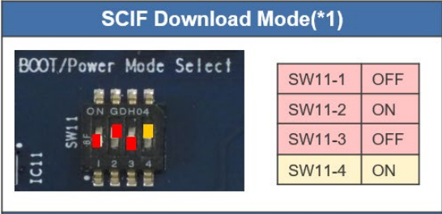
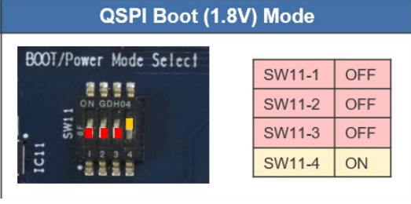

# RZ/G2L SMARC EVK

Renesas RZ/G2L SMARC Evaluation Board Kit.

| Item              | Value                                   |
| ----------------- | --------------------------------------- |
| Device tree       | `r9a07g044l2-smarc.dtb`                 |
| Variants          | PMIC and non-PMIC (different Flash Writer and bootloader files) |
| Boot mode switch  | SW11                                    |
| Serial console    | `ttySC0`, 115200 bps                    |
| Ethernet (U-Boot) | `ethernet@11c20000`                     |
| Kernel / DTB load | `0x48080000` / `0x48000000`             |

## Boot mode switches

| Mode           | SW11                                                         |
| -------------- | ------------------------------------------------------------ |
| SCIF download  | { width="300" }|
| Normal boot    | { width="300" }|

## Bootloader flash addresses

| File | Program Top | Save Address |
| ---- | ----------- | ------------ |
| BL2  | `11E00`     | `00000`      |
| FIP  | `00000`     | `1D200`      |

See [Flashing the bootloader](../guides/flash-bootloader.md) for file names and the procedure.

## MMC devices

| Medium                   | Linux device   | U-Boot device |
| ------------------------ | -------------- | ------------- |
| eMMC (on SoM)            | `/dev/mmcblk0` | `mmc 0`       |
| micro SD (carrier board) | `/dev/mmcblk1` | `mmc 1`       |
