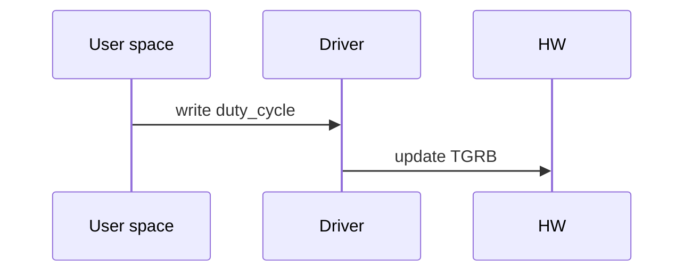

# BSP Manual

How the BSP modules work inside: architecture, data flow, driver internals and mapping tables. One page per module.

| Module                 | Driver                        | Notes from      |
| ---------------------- | ----------------------------- | --------------- |
| [MTU3 PWM](mtu3-pwm.md) | `drivers/pwm/pwm-rz-mtu3.c`   | RZ/G3S          |

## Page template

````markdown
# <Module name>

Driver: `drivers/<subsystem>/<file>.c`
Checked on: RZ/G3S (BSP version, kernel version)

## Overview
What the hardware block does and how Linux exposes it (sysfs, /dev, framework).

## Architecture


## Device tree
The node and properties the driver needs.

## Driver internals
Probe flow, key structs, lookup tables.

## Test from user space
Commands to check that it works.
````

## Diagrams

Diagrams are written as [Mermaid](https://mermaid.js.org/) code blocks and follow the light/dark theme automatically:

````markdown

````

Use `flowchart` for blocks and data paths, `sequenceDiagram` for call flows and `stateDiagram-v2` for state machines. For diagrams Mermaid cannot draw (pinmux, clock trees), export an SVG from draw.io or Excalidraw into `docs/imgs/`.
