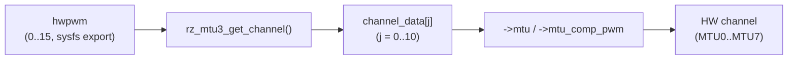

# MTU3 PWM

Driver: `drivers/pwm/pwm-rz-mtu3.c`

The channel map below was written for the **RZ/G3S**.

## Lookup chain



- `hwpwm` (0..15): the PWM number seen by the user in sysfs (`export`).
- `j` (0..10): the index into `channel_data[]` and `channel_map[]`.
- Do not confuse these two numbers.

## PWM mode 1

Each IO pin is an independent PWM.

| hwpwm | Pin     | HW channel | `channel_data[j]` | `channel_map[j]` {base, num_ios} |
|------:|---------|------------|:-----------------:|:--------------------------------:|
| 0     | MTIOC0A | MTU0       | [0]               | {0, 2}                           |
| 1     | MTIOC0C | MTU0       | [0]               | {0, 2}                           |
| 2     | MTIOC1A | MTU1       | [1]               | {2, 1}                           |
| 3     | MTIOC2A | MTU2       | [2]               | {3, 1}                           |
| 4     | MTIOC3A | MTU3       | [3]               | {4, 2}                           |
| 5     | MTIOC3C | MTU3       | [3]               | {4, 2}                           |
| 6     | MTIOC4A | MTU4       | [4]               | {6, 2}                           |
| 7     | MTIOC4C | MTU4       | [4]               | {6, 2}                           |
| 8     | MTIOC6A | MTU6       | [5]               | {8, 2}                           |
| 9     | MTIOC6C | MTU6       | [5]               | {8, 2}                           |
| 10    | MTIOC7A | MTU7       | [6]               | {10, 2}                          |
| 11    | MTIOC7C | MTU7       | [6]               | {10, 2}                          |

Register selection rule in mode 1:

- `base == hwpwm`: pin A, uses TIORH, TGRA (period), TGRB (duty).
- `base != hwpwm`: pin C, uses TIORL, TGRC (period), TGRD (duty).

## Complementary PWM

Each PWM is a bundle of two pin pairs and uses two HW channels.

| hwpwm | Type    | Pair 1 (MTU3/MTU6) | Pair 2 (MTU4/MTU7) | HW channels | `channel_data[j]` | `channel_map[j]` |
|------:|---------|--------------------|--------------------|-------------|:-----------------:|:----------------:|
| 12    | `BD_AC` | MTIOC3B + 3D       | MTIOC4A + 4C       | MTU3 + MTU4 | [7]               | {12, 1}          |
| 13    | `BD_BD` | MTIOC3B + 3D       | MTIOC4B + 4D       | MTU3 + MTU4 | [8]               | {13, 1}          |
| 14    | `BD_AC` | MTIOC6B + 6D       | MTIOC7A + 7C       | MTU6 + MTU7 | [9]               | {14, 1}          |
| 15    | `BD_BD` | MTIOC6B + 6D       | MTIOC7B + 7D       | MTU6 + MTU7 | [10]              | {15, 1}          |

Notes:

- `channel_data[7]` and `[8]` both point to MTU3 + MTU4. `[9]` and `[10]` both point to MTU6 + MTU7. They share the same hardware and differ only in which pins are enabled through TOER.
- The enum name reads as "pair of MTU3/6" _ "pair of MTU4/7".

## `channel_map[]`

```c
static const struct rz_mtu3_channel_io_map channel_map[] = {
	{ 0, 2 }, { 2, 1 }, { 3, 1 }, { 4, 2 }, { 6, 2 }, { 8, 2 }, { 10, 2 },
	{ 12, 1 }, { 13, 1 }, { 14, 1 }, { 15, 1 }
};
```

- `j = 0..6`: mode 1.
- `j = 7..10`: complementary.
- Lookup rule: `channel_data[j]` serves `hwpwm` in the range `[base, base + num_ios)`.
