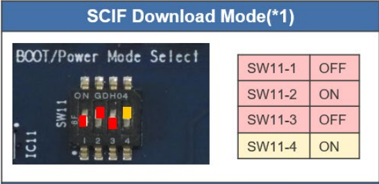
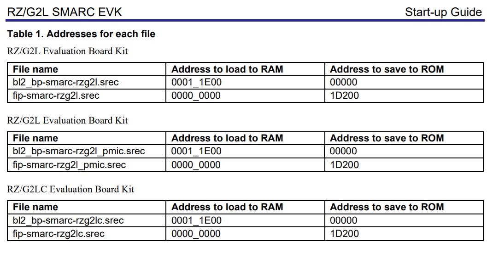
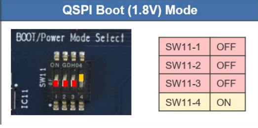
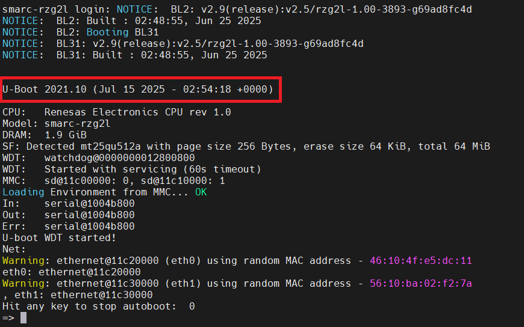

# Flashing the bootloader

The bootloader (BL2 + FIP with TF-A and U-Boot) lives in the SPI flash of the board. To write it, the board is put into **SCIF download mode**, a small program called the **Flash Writer** is sent to RAM over the serial console, and the Flash Writer then writes the BL2 and FIP files into flash with the `XLS2` command.

The procedure is the same on every board. Only the file names, the flash addresses and the boot mode switches change. Pick your board in the tabs below; the choice is remembered on every page.

## Inputs

All files come from the Yocto deploy directory (`build/tmp/deploy/images/<machine>/`).

=== "RZ/G2L"

    There are 2 versions of the RZ/G2L SMARC EVK: **PMIC** and **non-PMIC**.

    | File        | non-PMIC                                       | PMIC                                                  |
    | ----------- | ---------------------------------------------- | ----------------------------------------------------- |
    | Flash Writer| `Flash_Writer_SCIF_RZG2L_SMARC_DDR4_2GB.mot`   | `Flash_Writer_SCIF_RZG2L_SMARC_PMIC_DDR4_2GB_1PCS.mot` |
    | BL2         | `bl2_bp-smarc-rzg2l.srec`                      | `bl2_bp-smarc-rzg2l_pmic.srec`                         |
    | FIP         | `fip-smarc-rzg2l.srec`                         | `fip-smarc-rzg2l_pmic.srec`                            |

=== "RZ/G3S"

    | File         | Name                          |
    | ------------ | ----------------------------- |
    | Flash Writer | `FlashWriter-smarc-rzg3s.mot` |
    | BL2          | `bl2_bp_spi-smarc-rzg3s.srec` |
    | FIP          | `fip-smarc-rzg3s.srec`        |

=== "RZ/V2N"

    | File         | Name                                    |
    | ------------ | --------------------------------------- |
    | Flash Writer | `Flash_Writer_SCIF_RZV2N_DEV_LPDDR4X.mot` |
    | BL2          | `bl2_bp_spi-rzv2n-evk.srec`             |
    | FIP          | `fip-rzv2n-evk.srec`                    |

## Flash addresses

Values to type at the `XLS2` prompts (hex, without the `H'` prefix):

| Board  | BL2 Program Top | BL2 Save Address | FIP Program Top | FIP Save Address |
| ------ | --------------- | ---------------- | --------------- | ---------------- |
| RZ/G2L | `11E00`         | `00000`          | `00000`         | `1D200`          |
| RZ/G3S | `A1E00`         | `00000`          | `00000`         | `60000`          |
| RZ/V2N | `8101E00`       | `00000`          | `00000`         | `60000`          |

!!! note
    These addresses depend on the BSP version. If writing succeeds but the board does not boot, check the Start-up Guide that matches your BSP (see [Boards](../boards/index.md)).

## Serial console

Connect the debug serial port of the board to the host and open a terminal (Tera Term, `minicom`, `picocom`, ...) with **115200 bps, 8N1, no flow control**.

```bash
picocom -b 115200 /dev/ttyUSB0
```

## Boot mode: SCIF download

Power off the board and set the boot mode switches to **SCIF download**:

=== "RZ/G2L"

    Configure **SW11** as below:

    <div align="center" markdown="1">

    

    </div>

=== "RZ/G3S"

    Set **SW_MODE** (carrier board) as below:

    | SW_MODE | 1   | 2  | 3   | 4  |
    | ------- | --- | -- | --- | -- |
    | Setting | OFF | ON | OFF | ON |

=== "RZ/V2N"

    Set **DSW1** to **Boot mode 3 (SCIF download)**. See the figure in the RZ/V AI SDK guide for the switch positions.

Power on (or press RESET). The terminal shows:

```
SCIF Download mode
(C) Renesas Electronics Corp.
-- Load Program to SystemRAM ---------------
please send !
```

## Flashing

**1. Flash Writer**

Send the Flash Writer `.mot` file from the terminal (Tera Term: *File → Send file*). When it is loaded, the `>` prompt appears.

**2. BL2**

```
>XLS2
===== Qspi writing of RZ/G2 Board Command =============
Load Program to Spiflash
Writes to any of SPI address.
Micron : MT25QU512
Program Top Address & Qspi Save Address
===== Please Input Program Top Address ============
 Please Input : H'11E00
===== Please Input Qspi Save Address ===
 Please Input : H'00000
Work RAM(H'50000000-H'53FFFFFF) Clear....
please send ! ('.' & CR stop load)
```

Enter the **BL2** addresses of your board from the [table above](#flash-addresses), then send the BL2 `.srec` file. If the Flash Writer asks `SPI Data Clear(H'FF) Check ... Clear OK?(y/n)`, answer `y`.

**3. FIP**

```
>XLS2
===== Qspi writing of RZ/G2 Board Command =============
Load Program to Spiflash
Writes to any of SPI address.
Micron : MT25QU512
Program Top Address & Qspi Save Address
===== Please Input Program Top Address ============
 Please Input : H'00000
===== Please Input Qspi Save Address ===
 Please Input : H'1D200
Work RAM(H'50000000-H'53FFFFFF) Clear....
please send ! ('.' & CR stop load)
```

Enter the **FIP** addresses of your board, then send the FIP `.srec` file.

The logs above are from the RZ/G2L. The messages differ slightly on other boards, but the prompts are the same.

=== "RZ/G2L"

    <div align="center" markdown="1">

    

    </div>

=== "RZ/G3S"

    !!! tip
        The RZ/G3S Flash Writer supports a `SUP` command to raise the transfer rate from 115200 to 921600 bps before `XLS2`. Change the terminal speed to match, and change it back to 115200 bps when writing is done.

=== "RZ/V2N"

    No board-specific notes.

## Boot

When both files are written, power off, set the switches back to **normal boot** and power on again.

=== "RZ/G2L"

    Set **SW11** to normal boot:

    <div align="center" markdown="1">

    

    </div>

=== "RZ/G3S"

    Set **SW_MODE** to SPI boot:

    | SW_MODE | 1   | 2   | 3   | 4  |
    | ------- | --- | --- | --- | -- |
    | Setting | OFF | OFF | OFF | ON |

=== "RZ/V2N"

    Set **DSW1** to **Boot mode 2 (xSPI boot)**.

You should see U-Boot start, for example on the RZ/G2L:

<div align="center" markdown="1">



</div>
