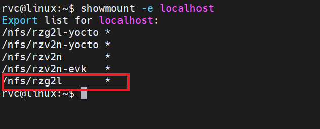
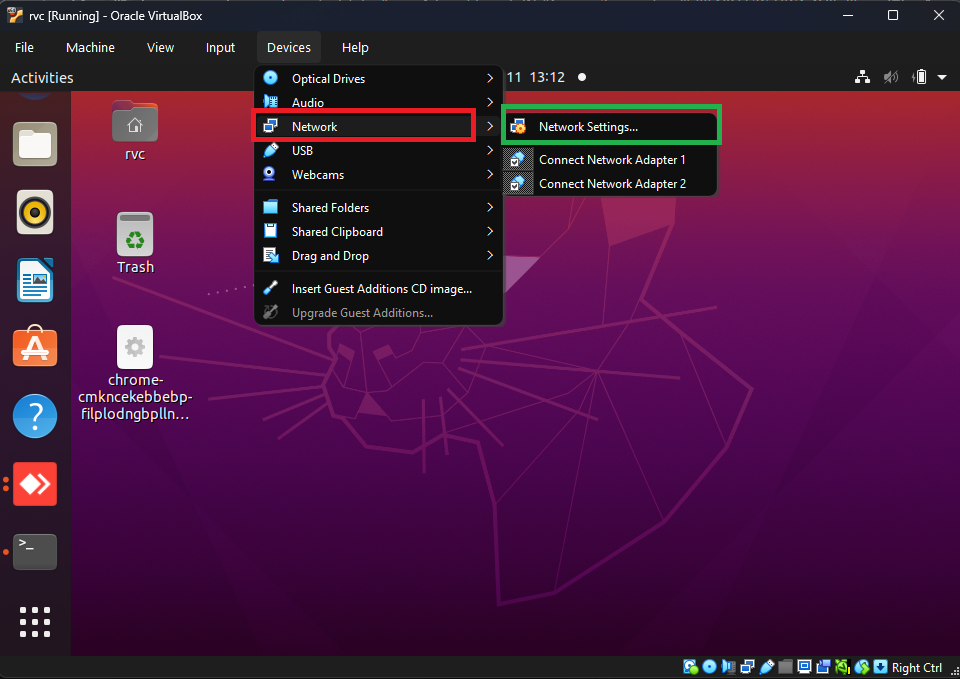
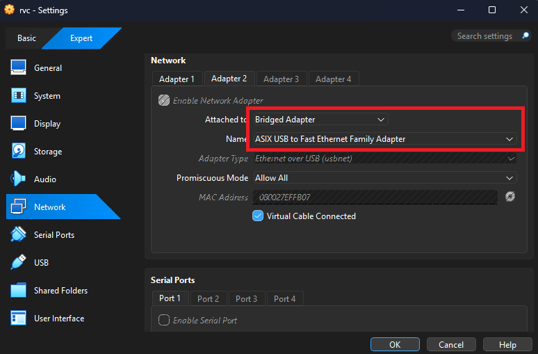
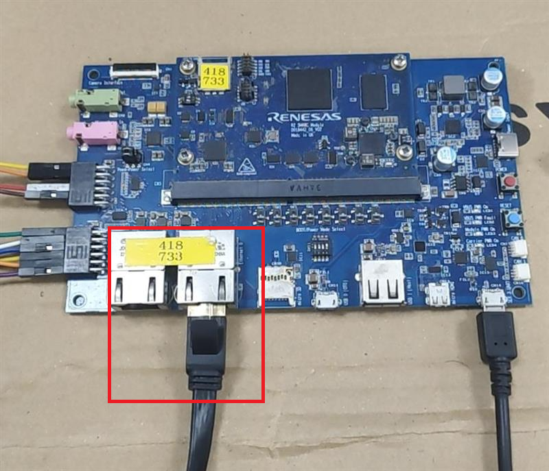

# Booting with TFTP and NFS

During development, the fastest loop is to keep everything on the host: U-Boot loads the kernel `Image` and the device tree over **TFTP**, and the kernel mounts its root filesystem over **NFS**. A rebuilt kernel or a changed file in the rootfs is picked up on the next boot without touching the board's storage.

```
Host (Ubuntu)                          Board
/srv/tftp/Image, <board>.dtb  --TFTP-->  U-Boot (RAM)
/nfs/<board>/  (rootfs)       --NFS--->  Linux root=/dev/nfs
```

The host setup is the same for every board. Only the device tree name (and, if they differ, the load addresses) change in the [U-Boot config](#u-boot-config-on-the-board).

## Set up the TFTP server

Install tftp-hpa (`/srv/tftp/` is used as the TFTP directory):

```bash
sudo apt-get install tftpd-hpa
```

Check the status of tftpd-hpa:

```bash
service tftpd-hpa status
```

Disable the firewall:

```bash
sudo ufw disable
```

## Set up the NFS server

Install the NFS server:

```bash
sudo apt-get install nfs-kernel-server
```

Start the NFS server:

```bash
sudo /etc/init.d/nfs-kernel-server start
```

Check the status of the NFS service:

```bash
service nfs-kernel-server status
```

Create one directory per board, for example `/nfs/rzg2l`:

```bash
sudo mkdir -p /nfs/rzg2l
```

Open `/etc/exports`:

```bash
sudo vim /etc/exports
```

Add one line per board directory:

```
/nfs/rzg2l *(rw,no_subtree_check,sync,no_root_squash)
```

Make the NFS server read `/etc/exports` again:

```bash
sudo exportfs -a
```

Confirm the export is active:

```bash
showmount -e localhost
```

<div align="center" markdown="1">



</div>

## Prepare Image, DTB and rootfs

Copy `Image` and the device tree of your board to `/srv/tftp/`:

```bash
sudo cp <Image path> <device tree path> /srv/tftp/
```

| Board  | Device tree                  |
| ------ | ---------------------------- |
| RZ/G2L | `r9a07g044l2-smarc.dtb`      |
| RZ/G3S | `r9a08g045s33-smarc.dtb`     |
| RZ/V2N | `r9a09g056n48-rzv2n-evk.dtb` |

Extract the rootfs (`*.tar.bz2`) into the board directory:

```bash
sudo tar -xf <rootfs>.tar.bz2 -C /nfs/rzg2l
```

## Set a static IP on the host

If the host is a virtual machine, attach a network adapter in bridged mode to the Ethernet port connected to the board.

Select *Devices → Network → Network Settings*:

<div align="center" markdown="1">



</div>

Configure the adapter as below:

<div align="center" markdown="1">



</div>

Find the interface connected to the board with `ifconfig` (or `ip addr`):

```bash
rvc@linux:~$ ifconfig
enp0s3: flags=4163<UP,BROADCAST,RUNNING,MULTICAST>  mtu 1500
        inet 10.0.2.15  netmask 255.255.255.0  broadcast 10.0.2.255
        ...

enx080027effb07: flags=4163<UP,BROADCAST,RUNNING,MULTICAST>  mtu 1500
        inet 192.168.1.3  netmask 255.255.255.0  broadcast 192.168.1.255
        ether 08:00:27:ef:fb:07  txqueuelen 1000  (Ethernet)
        ...
```

In this example the board is on **enx080027effb07**. To make the static IP permanent, add to `/etc/network/interfaces`:

```
auto lo
iface lo inet loopback

iface enx080027effb07 inet static
address 192.168.1.3   # <IP>
netmask 255.255.255.0 # <netmask>
```

Then reboot. To set it only for the current session:

```bash
sudo ifconfig enx080027effb07 192.168.1.3
```

The rest of this page uses **192.168.1.3** for the host and **192.168.1.5** for the board.

## Connect the host and the board

Connect the serial console and an Ethernet port of the board to the host.

=== "RZ/G2L"

    <div align="center" markdown="1">

    

    </div>

=== "RZ/G3S"

    No picture yet.

=== "RZ/V2N"

    No picture yet.

## U-Boot config on the board

Power on the board and press any key to stop autoboot.

Set a MAC address (only needed if U-Boot reports `address not set`):

```
setenv ethaddr 74:90:50:00:00:d6
```

Set the board IP and the server IP:

```
setenv ipaddr 192.168.1.5
setenv serverip 192.168.1.3
```

Set `bootcmd` to load the kernel and the device tree over TFTP, and `bootargs` to mount the rootfs over NFS:

=== "RZ/G2L"

    ```
    setenv bootcmd 'tftp 0x48080000 Image; tftp 0x48000000 r9a07g044l2-smarc.dtb; booti 0x48080000 - 0x48000000'
    setenv bootargs 'console=ttySC0,115200n8 ip=192.168.1.5:192.168.1.3::::eth0 rootwait root=/dev/nfs rw nfsroot=192.168.1.3:/nfs/rzg2l,nfsvers=3,tcp noinitrd nohlt panic=1 earlyprintk=ttySC0,115200n8'
    ```

=== "RZ/G3S"

    ```
    setenv bootcmd 'tftp 0x48080000 Image; tftp 0x48000000 r9a08g045s33-smarc.dtb; booti 0x48080000 - 0x48000000'
    setenv bootargs 'console=ttySC0,115200n8 ip=192.168.1.5:192.168.1.3::::eth0 rootwait root=/dev/nfs rw nfsroot=192.168.1.3:/nfs/rzg3s,nfsvers=3,tcp'
    ```

    The load addresses match the default boot of the RZ/G3S Start-up Guide. The `bootargs` have not been tested on this board yet.

=== "RZ/V2N"

    Not tested yet. Read the default environment first and reuse its load addresses and console:

    ```
    printenv bootcmd bootargs
    ```

    Device tree: `r9a09g056n48-rzv2n-evk.dtb`.

What the parameters mean:

- `tftp <addr> <file>`: load a file from `serverip` into RAM.
- `booti <kernel> - <fdt>`: boot an arm64 `Image`. The `-` means there is no initramfs.
- `ip=<board>:<server>::::eth0`: configure the network in the kernel before mounting the rootfs.
- `root=/dev/nfs nfsroot=<server>:<dir>`: mount the rootfs over NFS.

!!! tip
    On a new board, `printenv` shows the default `bootcmd` and `bootargs`. Reuse its load addresses and `console=` value, and change only the TFTP and NFS parts.

Save the environment if you want the board to always boot this way (optional):

```
saveenv
```

Check the connection:

```
ping 192.168.1.3
```

Boot:

```
boot
```

Expected log (RZ/G2L):

```
Hit any key to stop autoboot:  0
Using ethernet@11c20000 device
TFTP from server 192.168.1.3; our IP address is 192.168.1.5
Filename 'Image'.
Load address: 0x48080000
Loading: #################################################################
         ...
done
Bytes transferred = 25963008 (18c2a00 hex)
Using ethernet@11c20000 device
TFTP from server 192.168.1.3; our IP address is 192.168.1.5
Filename 'r9a07g044l2-smarc.dtb'.
Load address: 0x48000000
Loading: ###
done
Bytes transferred = 39425 (9a01 hex)
Moving Image from 0x48080000 to 0x48200000, end=49b80000
## Flattened Device Tree blob at 48000000
   Booting using the fdt blob at 0x48000000
   Loading Device Tree to 0000000057ff3000, end 0000000057fffa00 ... OK

Starting kernel ...
```
